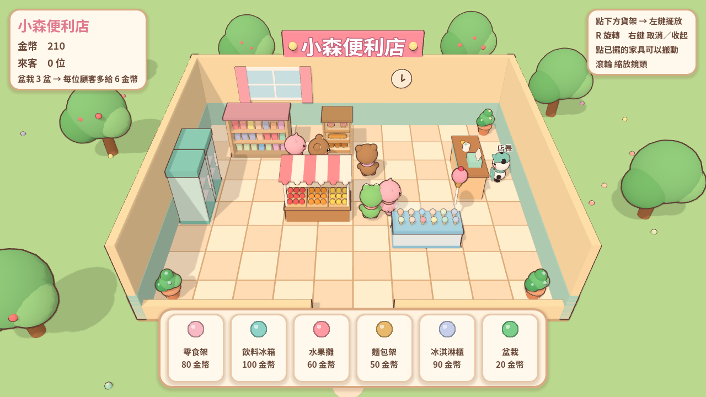

# 711demo — 小森便利店

用 Godot 4.7 做的迷你 3D 便利商店擺貨架遊戲 Demo。可愛療癒的繪本風，顧客都是小動物。

**▶ 線上試玩：https://tmchouys.github.io/711demo/**

## 玩法

- 點下方快捷列（或按 1～6）選貨架，綠色格子＝可以放，左鍵擺放
- **R** 旋轉，**右鍵** 取消／收起已擺的家具（全額退回金幣）
- 點已擺好的家具可以搬動，滾輪縮放鏡頭
- 動物顧客會進店逛貨架、到收銀台結帳，賺到的金幣可以再買新貨架
- 每盆盆栽讓每位顧客多給 2 金幣

## 內容

- 6 種貨架：零食架、飲料冰箱、水果攤、麵包架、冰淇淋櫃、盆栽
- 7 種動物顧客：貓、熊、兔子、青蛙、小豬、熊貓、狐狸，還有熊貓店長
- 所有模型都由程式用基本形狀組成（[art.gd](art.gd)），沒有外部美術素材

## 專案結構

| 檔案 | 內容 |
| --- | --- |
| [main.gd](main.gd) | 網格、擺放、UI、場景 |
| [customer.gd](customer.gd) | 顧客的行動流程與尋路 |
| [art.gd](art.gd) | 家具、動物模型與描邊效果 |
| [fonts/](fonts) | Noto Sans TC 子集字型（只含遊戲用到的字，[SIL OFL](https://openfontlicense.org)） |

## 本機執行

用 Godot 4.7 開啟 `project.godot`，按 F5。

## 部署

推送到 `main` 時，GitHub Actions（[.github/workflows/pages.yml](.github/workflows/pages.yml)）會下載 Godot、匯出 Web 版並發佈到 GitHub Pages。
